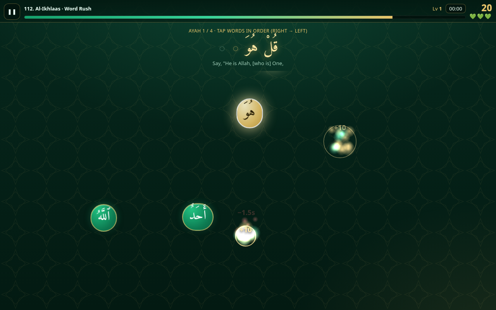

# Quran Rush ✦ سِبَاقُ ٱلْحِفْظِ

A fast-paced, tap-heavy arcade game for memorizing the Quran. It covers **Al-Fatiha and all of Juz ʿAmma (surahs 78–114)**. The theme is emerald and gold, with gentle glow-and-collect effects.

**Play:** https://mrbugimposter3-ship-it.github.io/quran-rush/

## Modes
| Mode | How it plays |
|---|---|
| **Word Rush** | The words of an ayah float around the screen. Tap them in reading order (right → left) before the timer bar empties. Long ayahs arrive in waves of 5–7 words. From level 3, decoy words from other ayahs join in. A wrong tap costs 1.5 s and resets your streak. |
| **Next Ayah Blitz** | A 60-second round. You're shown an ayah; tap the ayah that comes **next** among 4 moving cards. From level 4 the cards also swap lanes. A wrong tap costs 3 s. |
| **Missing Word Catch** | An ayah is shown with one word missing. Catch the right word as glowing orbs fly past. Orbs get faster and more numerous as you level up. |

After every correct ayah, a short **learning card** shows the full ayah in Arabic with transliteration and the Sahih International translation. Tap it to skip.

* **Pace:** Calm, Fast or Blazing sets the starting level. Difficulty rises every 2 ayahs: things move faster, there are more decoys and you get less time.
* **Scoring:** a streak multiplier (up to ×8), a time bonus, 3 hearts in Word Rush and Missing Word Catch, and a run clock in the HUD. The clock counts only active play, not time spent on learning cards.
* **Progress** is saved in `localStorage`: player level and XP, best score and fastest full-surah time per mode, and a mastery bar for each surah. A ★ marks a fully mastered surah.
* **Recitation** (off by default): turn on 🎧 to hear Mishary Alafasy recite each ayah on its learning card.
* Works with mouse or touch, on desktop and mobile. Esc or P pauses.

## Run locally
No build step. Serve the folder with `python3 -m http.server 8000`, then open http://localhost:8000.

## Sources & licenses
* **Arabic text:** Uthmani script from the [Tanzil Project](https://tanzil.net), via the [Al Quran Cloud API](https://alquran.cloud/api) (`quran-uthmani`). Tanzil's terms allow verbatim redistribution with attribution, and the text has not been modified. Quranic pause marks are kept attached to their words.
* **Transliteration:** Al Quran Cloud `en.transliteration`.
* **English translation:** Saheeh International (`en.sahih`).
* **Recitation (optional, streamed, not bundled):** Mishary Rashid Alafasy, from `cdn.islamic.network` (Islamic Network / Al Quran Cloud). For non-commercial use.
* **Font:** [Amiri](https://github.com/aliftype/amiri), SIL Open Font License 1.1 (see `fonts/OFL-Amiri.txt`).
* **Game code:** MIT. Sound effects are generated in the browser with WebAudio, so there are no audio files.

Please double-check your memorization with a qualified teacher. This game is a practice aid.
