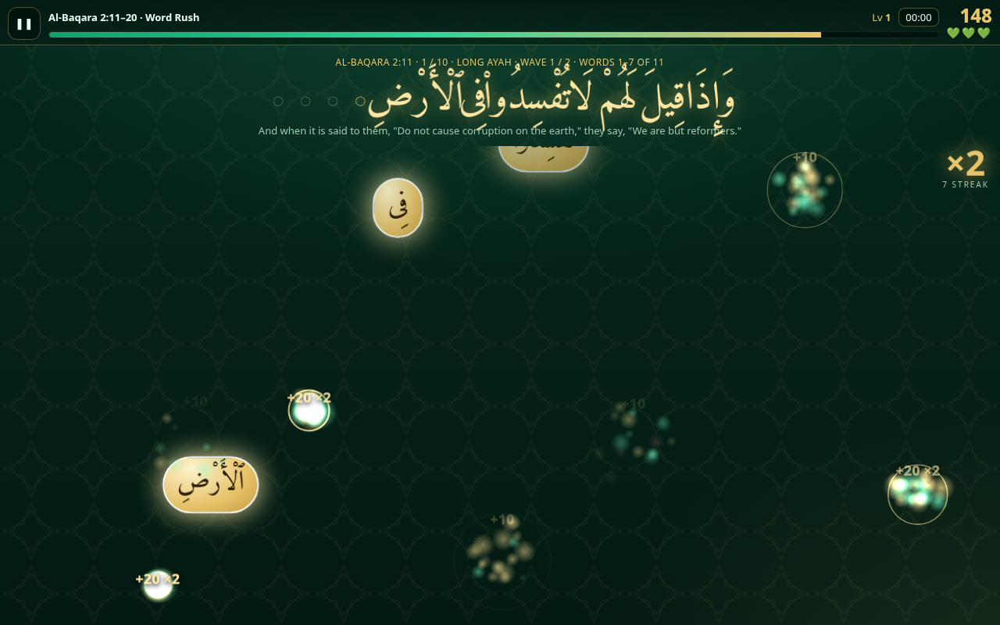

# Quran Rush ✦ سِبَاقُ ٱلْحِفْظِ

A fast-paced, tap-heavy arcade game for memorizing **the whole Quran: all 114 surahs, 6236 ayahs**. The theme is emerald and gold, with gentle glow-and-collect effects.

**Play:** https://mrbugimposter3-ship-it.github.io/quran-rush/

## Modes
| Mode | How it plays |
|---|---|
| **Word Rush** | The words of an ayah float around the screen. Tap them in reading order (right → left) before the timer runs out. Long ayahs come in **waves** of 5–7 words, each with its own timer; 2:282 has 19 waves. From level 3, decoy words join in. |
| **Next Ayah Blitz** | A 60-second round. You're shown an ayah; tap the ayah that comes **next** among 4 moving cards. Cards show as many words as it takes (up to 14) to tell them apart. For very long ayahs, the prompt shows their last words. |
| **Missing Word Catch** | One word is missing. Catch it as glowing orbs fly past. For long ayahs, only the words around the gap are shown. |

## What to practise
* **📖 Surahs:** search by name, number or Arabic (`baqarah`, `36`, `الملك`), or jump straight to an ayah with `2:255`.
  * Surahs with more than 10 ayahs open a section picker: **Continue from 2:45** (it remembers where you left off), the whole surah, sections of 5, 10 or 20 ayahs with stars, or a custom ayah range.
* **🧭 Juz:** all 30 Juz, played by hizb quarter (rubʿ) or as a whole.
* **🎲 Juz Challenge:** 10, 20 or 30 random ayahs from a Juz you choose, with a new draw every round.
* **📿 My Daily Wird:** drill exactly the ayahs you logged in [Quran Recorder](https://mrbugimposter3-ship-it.github.io/quran-recorder/).
  * Choose today, a specific date, the last 7 days or everything logged.
  * Shows per-day mastery stars and a streak calendar (green = ayahs logged, gold ring = practised here).
  * Logs come from two places: the public [`quran-recorder/logs/`](https://github.com/mrbugimposter3-ship-it/quran-recorder/tree/main/logs) folder via the GitHub API, and the recorder's own browser storage (`quranRecorder.logs.v1`). Both apps are on the same github.io origin, so they share browser storage.

**Stars:** ★ for ⅓ of a section mastered, ★★ for ⅔, ★★★ for all of it. Progress, best scores, fastest whole-surah times, XP and level are saved in `localStorage` (`quranRush.v1`), and saves from version 1 still work.

## Performance
The page loads only `data/meta.js` (16 KB: surah names, Juz and hizb boundaries). Ayah text is lazy-loaded one surah at a time from `data/s/NNN.json`; Al-Baqarah is the largest at about 71 KB gzipped.

## Run locally
Serve the folder with `python3 -m http.server 8000`, then open http://localhost:8000. Opening the file directly won't work, because the ayah text is fetched.

## Sources & licenses
* **Arabic:** Uthmani script from the [Tanzil Project](https://tanzil.net), via [Al Quran Cloud](https://alquran.cloud/api) `quran-uthmani`. Tanzil's terms allow verbatim redistribution with attribution.
  * The only changes: the byte-order mark is removed, and the Basmala prefix is removed from ayah 1 of every surah except Al-Fatiha (where it is ayah 1). At-Tawbah has no Basmala.
  * All 112 removals were checked, including the `بِّسْمِ` spelling in 95:1 and 97:1.
* **Transliteration:** Al Quran Cloud `en.transliteration`. **English:** Saheeh International (`en.sahih`).
* **Recitation (optional, streamed):** Mishary Rashid Alafasy, from `cdn.islamic.network`. For non-commercial use.
* **Font:** [Amiri](https://github.com/aliftype/amiri), SIL OFL 1.1 (`fonts/OFL-Amiri.txt`). **Game code:** MIT.

Please double-check your memorization with a qualified teacher. This game is a practice aid.
